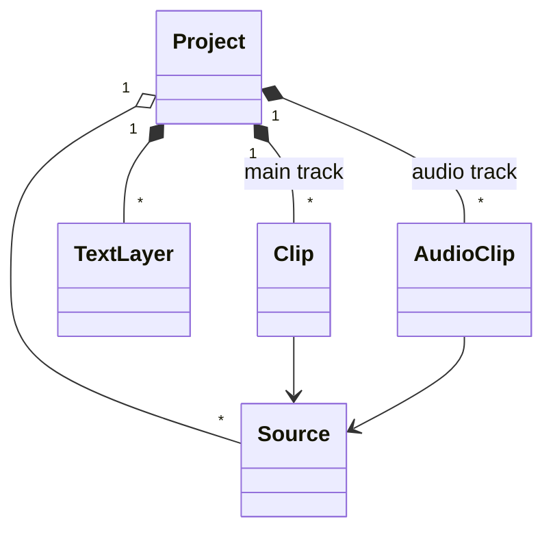

# Domain model

All times are stored as integer microseconds (µs); prose uses seconds. The project exists only in
memory for the session (PRN-01). Schema: `project.schema.json`.

### ENT-Project — Project
The frame settings (aspect, frame rate, background; RULE-04), the sources in the media panel, the
ordered clips of the main track, the text layers (in stacking order) and the audio clips. Its
length is the main track's length (INV-03, RULE-03). One project per session.

### ENT-Source — Source
A file the user added (RULE-01, RULE-02): kind (`video`, `photo`, `audio`), display name, byte
size, and what was read when it was probed: duration, picture size after orientation, frame
rate, and whether it has sound. Holds a reference to the file for the session only; the file
itself is never changed or copied off the device (INV-01).

### ENT-Clip — Clip
A video or photo on the main track. Video: the source range used (in, out) and speed (RULE-06).
Photo: a duration (RULE-05). Both: placement (RULE-07), adjustments (RULE-08), colour tools
(RULE-24, RULE-25; optional, absent means every tool at its default), look and intensity
(RULE-09), fade in and fade out, and the cross-fade into the next clip (RULE-10). Video only:
volume and mute (RULE-12). A clip's length on the timeline follows RULE-05 and RULE-06.

### ENT-TextLayer — Text layer
Text content, start and end time, typeface, size, colour, style, alignment, position in the frame
and fade on/off (RULE-11). Later layers draw on top of earlier ones.

### ENT-AudioClip — Audio clip
A range of an audio source (in, out) placed at a start time on the audio track, with volume, mute,
fade in and fade out (RULE-12).

### ENT-MusicTrack — Music track (deprecated)
Removed by D-052 (2026-11-25): the tool ships no music, and an audio clip always refers to a source.
Kept for history so the ID is never reused; nothing may refer to it.

### ENT-ExportSettings — Export settings
What the next export produces: kind (video, animated image, audio), and for each kind its choices
(RULE-15, RULE-16). Kept for the session; not part of undo (RULE-13).

## Invariants
- **INV-01** Sources are never modified. No source data, frame, sound or project content leaves
  the device, and none survives the session except export scratch space that a closing page could
  not delete in time: scratch space is deleted when its export fails or is cancelled, and after a
  success once the browser has taken the file (or, if the page closes first, the next time the tool
  opens); any other scratch left behind is also deleted the next time the tool opens. Where the
  browser keeps separate storage for the tool embedded in the host and opened on its own, "the next
  time the tool opens" means the next time it opens in that same context; each is swept separately.
- **INV-02** For the same project time, the preview and an export show the same picture and play
  the same sound, as far as the export kind carries them: a video export has both, a GIF has the
  picture only (at its own size, frame rate and colour limits), an audio export the sound only. The
  other differences come only from output resolution and the encoder's compression (PRN-02).
- **INV-03** Main-track clips sit end to end from time 0 with no gaps. Each cross-fade overlaps two
  neighbours by its duration. The project length is the main track's end.
- **INV-04** The project length never exceeds the limit in RULE-03.
- **INV-05** The UI language and theme never change any export.
- **INV-06** Audio clips never overlap each other on the audio track.
- **INV-07** Text layers and audio clips may extend past the project end, but nothing past the end
  is previewed or exported.
- **INV-08** The only message the tool sends to the host is the ready signal, and it never carries
  content (RULE-17).
