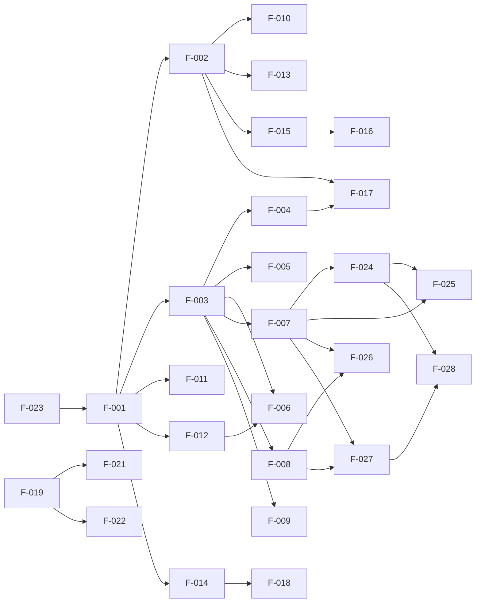

# Feature map

| ID | Title | Milestone | Priority | Status |
|---|---|---|---|---|
| F-001 | Add media | M-1 | P0 | shipped |
| F-002 | Play and scrub the preview | M-1 | P0 | shipped |
| F-003 | Arrange clips on the main track | M-1 | P0 | shipped |
| F-004 | Trim and split clips | M-1 | P0 | shipped |
| F-005 | Change clip speed | M-1 | P1 | shipped |
| F-006 | Place, rotate and flip clips | M-1 | P0 | shipped |
| F-007 | Adjust colour and light | M-1 | P0 | shipped |
| F-008 | Apply a look | M-1 | P0 | shipped |
| F-009 | Fade and cross-fade | M-1 | P1 | shipped |
| F-010 | Add text | M-1 | P0 | shipped |
| F-011 | Add music and set sound | M-1 | P0 | shipped |
| F-012 | Set the frame | M-1 | P0 | shipped |
| F-013 | Navigate the timeline | M-1 | P1 | shipped |
| F-014 | Undo and redo | M-1 | P0 | shipped |
| F-015 | Export video | M-1 | P0 | shipped |
| F-016 | Export an animated image or audio | M-1 | P2 | shipped |
| F-017 | Control by keyboard and touch | M-1 | P1 | shipped |
| F-018 | Warn before losing work | M-1 | P1 | shipped |
| F-019 | Fit into the host portal | M-1 | P0 | shipped |
| F-020 | Show the privacy guarantee | M-1 | P1 | shipped |
| F-021 | Work offline | M-1 | P2 | shipped |
| F-022 | Use the portal's language | M-1 | P1 | shipped |
| F-023 | Check device support | M-1 | P0 | shipped |
| F-024 | Mix colours by range | M-4 | P1 | shipped |
| F-025 | Keep one colour (colour pop) | M-4 | P1 | shipped |
| F-026 | Tint shadows and highlights (split toning) | M-4 | P2 | shipped |
| F-027 | Recolour in two colours (duotone) | M-4 | P2 | shipped |
| F-028 | Replace a colour | M-5 | P2 | shipped |

