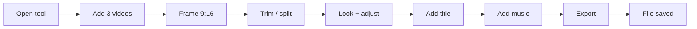

## Goal
Turn three phone videos into a 9:16 clip with a title, a look and music, and save it.

## Diagram

## Steps
1. Open the tool — SCR-Editor (empty) — F-023.R1
2. Add three videos — F-001.R1, F-001.R3
3. Choose 9:16 — F-012.R1
4. Trim the starts and split out a dull middle — F-004.R1, F-004.R2, F-003.R3
5. Choose a look and raise Brightness, then Apply to all — F-008.R2, F-007.R1, F-007.R4
6. Add a title — F-010.R1, F-010.R2
7. Add bundled music — F-011.R1
8. Watch it — F-002.R2
9. Export at 1080p — F-015.R1, F-015.R5

## Exits & failures
- Closing the page with unexported changes → warning (F-018.R1).
- Export fails → the project stays as it was; lower the resolution and retry (F-015.R6).
