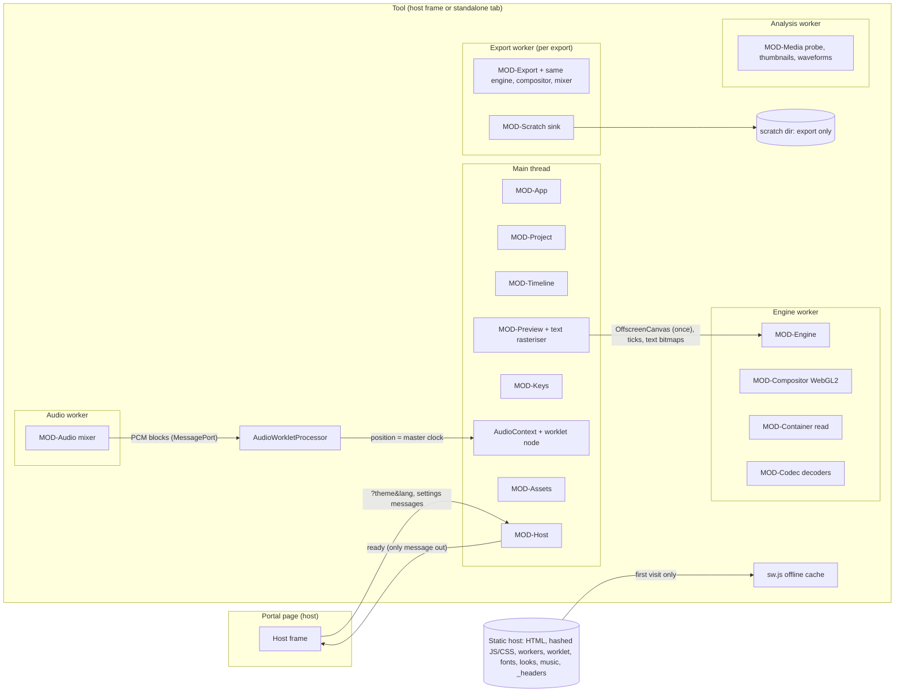
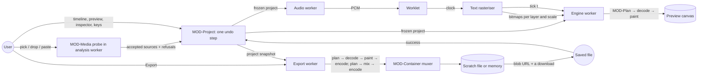

# Architecture

Status: **proposed** (phase 3.1, 2026-11-03), awaiting spikes and the owner's decisions. Decisions:
ADR-0001 … ADR-0016 (all `proposed`). Modules: `modules/`. Dependencies: `dependencies.md`.
Platform details: `platform-mapping.md`. Source proposal:
`.build-my-app/reports/architecture-proposal.md`.

## Summary
A static single-page web app at its own address, embedded by the TaroKit portal in a sandboxed
frame and fully usable standalone (PRN-05, RULE-17). It reuses the suite's baseline unchanged
(ADR-0002): **Preact + signals, strict TypeScript, Vite, pnpm, portal tokens, generated EN/VI copy,
the host message contract, a hand-written offline service worker, Cloudflare static assets, local
checks only**. What video adds is our own media engine on browser platform features:
**WebCodecs** for every decode and encode with a start-up capability probe and a defined output
fallback order (ADR-0004); **mediabunny** to read and write files in pieces, under a scoped MPL-2.0
exception that the owner must approve, with a permissive fallback (ADR-0005); **one WebGL2
`paint(t)`** for preview, thumbnails and every export, with RULE-08's grade, 3D look tables and
our own HDR→SDR shader (ADR-0006, ADR-0007); **one deterministic TypeScript mixer** for preview and
export with our own pitch-preserving time-stretch and true-peak limiter, played through an audio
worklet whose clock leads the picture (ADR-0008); bounded caches over streamed files (ADR-0009); and
an export worker that streams into a **scratch file only during export** (ADR-0010). Work is split
over four dedicated workers and a worklet **without** shared memory or cross-origin isolation, so
the portal's frame contract does not change (ADR-0003). One deliberate header difference from the
suite: `connect-src 'self'` so the tool can read its own look and music files (ADR-0014).

## Assumptions
- A1. Reference devices for the NFRs (owner to confirm the physical devices): **laptop** — Apple
  M1 MacBook Air, 8 GB, current macOS; **iPhone** — iPhone 13 class (A15, 4 GB), iOS 26;
  **Android** — Galaxy A5x class from 2024 (8 GB), current Android, Chrome.
- A2. NFR-12 browser list: desktop — the latest two stable versions of Chrome and Edge, Firefox,
  and Safari 26; phones — Safari on iOS 26 (latest two) and Chrome on Android (latest two).
  Firefox on Android has no codec API and gets SCR-Unsupported via RULE-22; other browsers follow
  RULE-22.
- A3. Addresses: production `https://clip-maker.tarokit.app`, embedded by `https://tarokit.app`;
  staging `https://clip-maker-staging.tarokit.app` (ADR-0014).
- A4. "MB" is 1,000,000 bytes (rules.md). Mixing rate 48 kHz stereo float.
- A5. The portal adds Clip Maker to its catalog with permissions `downloads`, `dialogs`,
  `fullscreen` (+ optional `popups`).
- A6. Spike results may change numbers in "Export tables" and "Budgets"; changes are recorded in
  superseding ADRs or here with the spike report.

## System context

After load, nothing leaves the tool except the ready signal and the browser's own service-worker
update check while opening (INV-08, NFR-01).

## Modules
| Module | Thread | Responsibility (short) | Main features |
|---|---|---|---|
| MOD-Core | any (pure) | Types, µs/frame maths, every rule's maths, export tables, file names, sniffing, message types | F-003, F-004, F-005, F-006, F-009, F-010, F-011, F-012, F-015 tables |
| MOD-Plan | any (pure) | Project + time → frame plan / audio plan (the INV-02 recipe) | F-002, F-005, F-009, F-010, F-011, F-016 |
| MOD-Project | main | Immutable project, operations, history, epoch, signals | F-001, F-003…F-012, F-014, F-018 |
| MOD-Media | analysis worker + main | Intake, probe, source registry, thumbnails, waveforms | F-001, F-023 |
| MOD-Container | workers | Read/write files in pieces (only user of DEP-04) | F-001, F-015, F-016 |
| MOD-Codec | workers | Capability probe, codec setup, output format choice | F-015, F-016, F-023 |
| MOD-Engine | engine worker | Preview decoding, frame cache, seeking, look thumbnails, sequential reader for export | F-002, F-008, F-013 |
| MOD-Compositor | engine + export workers | WebGL2 `paint`, grade, looks, HDR, blur background, text, CPU reference | F-002, F-006…F-010, F-012, F-015, F-016, F-023 |
| MOD-Audio | audio + export workers, main | Mixer, resample, WSOLA, limiter, worklet, clock | F-002, F-005, F-009, F-011, F-016 |
| MOD-Export | export worker + main | Video/GIF/audio export, sinks, rate control, progress, cancel | F-015, F-016, F-019 |
| MOD-Scratch | export worker + main | The only on-device storage, export-time only, sweeps | F-015, F-019 |
| MOD-Assets | main | Manifest, looks and music from own origin (only `fetch`) | F-008, F-011, F-021 |
| MOD-Timeline | main | Timeline canvas, pointer + touch (fixed centre playhead) | F-002, F-003, F-004, F-009, F-010, F-011, F-013, F-017 |
| MOD-Preview | main | Preview surface, on-preview gestures, compare, full screen, text raster + field | F-002, F-006, F-007, F-010, F-017 |
| MOD-App | main | Shell, panels, dialogs, notices, live regions, layout, leave-page | F-001, F-007, F-008, F-011, F-015, F-018, F-020, F-023 |
| MOD-Keys | main (pure core) | RULE-20 key map with scopes | F-017 |
| MOD-Host | boot + main + sw.js | Theme/language, origin-checked messages, ready, offline registration | F-019, F-021, F-022 |
| MOD-Copy | main + build | Generated catalog, formatting | F-022 |
| MOD-Build | build | Codegen, looks/music packing, headers, manifests, notices, gates | F-020, F-021 |

**Dependency rules (lint-enforced import boundaries, ADR-0002):** MOD-Core and MOD-Plan import no
DOM, worker, codec or GPU API; MOD-Project imports only MOD-Core; MOD-Compositor never reads
language, theme or view state beyond the plan and target size (INV-05); only MOD-Container imports
DEP-04; only MOD-Assets calls `fetch`; only MOD-Scratch touches `navigator.storage`; only MOD-Host
posts to the parent or touches the service worker; only MOD-App composes modules and registers
`beforeunload`; MOD-Copy is a leaf.

## Data flow

### Add media (F-001)
Each file: size → magic bytes → container headers → RULE-02 limits → real decoder configs →
first frame and first sound window decoded → accepted (source registry + media panel + thumbnail)
→ placement computed by MOD-Core (RULE-03, RULE-05, RULE-12) → the batch becomes one step. Refusals
are collected into COPY-error.refused_list. The file is never read whole (ADR-0009).

### Preview (F-002)
Play creates or resumes the `AudioContext` inside the gesture; the audio worker renders from the
playhead and the worklet starts. Each display frame, MOD-Preview reads the clock and sends the
wanted time to the engine worker; MOD-Engine asks MOD-Plan for the frame plan, ensures frames are
decoded, MOD-Compositor paints into the transferred canvas. Paused scrubbing sends the playhead
instead; the engine shows a cached thumbnail at once and the exact frame when decoded. Edits post
the new frozen project; caches are keyed by object identity, so unchanged clips keep their frames.

### Touch timeline (D-013, RULE-14) — implications
- Playhead = the time under the timeline's centre line; scroll offset and playhead are one value,
  so every scroll frame is a seek: the engine must coalesce seeks (latest wins) and show cached
  thumbnails while decoding (NFR-03).
- A touch scroll during playback first pauses (D-024), then scrubs; momentum scrolling ends on a
  frame start.
- The start and end of the project must be reachable at the centre, so the track content has
  half-a-view padding on both sides.
- Hold-to-move (0.4 s) and trim handles compete with scrolling; gesture arbitration lives in
  MOD-Timeline and is a design-review item. Every gesture has a visible control (RULE-21).
- Pointer input on the same device keeps the draggable playhead (D-026).

### Export (F-015, F-016)
The editor locks; the engine and audio workers release decoders; a fresh export worker gets the
project snapshot, text bitmaps at output scale (requested from the main thread on demand), the
looks and the capability record. Sink choice → trial encode → frames in order (sequential decode,
`paint`, `VideoFrame`, encode) and sound in 1 s blocks → muxer → sink → finalize → hand-over
(`<a download>`) → success marks the export (RULE-19, not for GIF) → scratch deletion per ADR-0010.
Cancel terminates the worker and deletes scratch within 1 s.

### Host and offline
As the suite (ADR-0002, ADR-0015): boot script before first paint, origin-checked messages, one
ready, service worker registered after first render that precaches the full asset manifest.

## Export tables (RULE-15, ADR-0010)
Video bitrates in kbps at 30 fps; × 1.5 at 60 fps; × 0.85 at 24 and 25 fps. Resolution = the
output's shorter side. Tuned by SP-size-target before acceptance.

| Resolution | Floor (size target) | Smaller | Balanced (default) | Best |
|---|---|---|---|---|
| 480 | 300 | 900 | 1,500 | 2,500 |
| 720 | 600 | 1,800 | 3,000 | 5,000 |
| 1080 | 1,000 | 3,500 | 6,000 | 10,000 |
| 1440 | 2,000 | 7,000 | 12,000 | 18,000 |
| 2160 | 4,000 | 14,000 | 24,000 | 36,000 |

Audio in video files: AAC-LC or Opus 128 kbps stereo 48 kHz. Audio-only: AAC 192 kbps or Opus
160 kbps; WAV 16-bit 48 kHz stereo. Size-target maths: video kbps = (X × 8,000 × 0.95 − audio
kbit − overhead) ÷ seconds, overhead = 1 % + 512 kbit. Worked check against F-015.AC2 (60 s, 4 MB):
≈ 370 kbps → 480 reachable, 720 and 1080 not; at 1 MB unreachable, smallest reachable whole-MB
target at 480 = 4 MB.

## Budgets and baselines

### Size (NFR-10: own code and styles ≤ 600 KB compressed at first load)
| Item (compressed) | Budget |
|---|---|
| HTML (boot script, inline icons) | ≤ 15 KB |
| CSS | ≤ 25 KB |
| Main JS (Preact, signals, app, project, core, plan, timeline, preview, keys, host, copy, assets) | ≤ 200 KB |
| Engine worker (container read, codec, engine, compositor + shaders) | ≤ 150 KB |
| Audio worker + worklet | ≤ 50 KB |
| Analysis worker (shared chunks counted once) | ≤ 30 KB extra |
| Export worker (muxers, gifenc, export) | ≤ 60 KB extra |
| **Code and styles total** | **≤ 530 KB** |
| Fonts (5 packages, latin + vietnamese) | ≈ 200 KB |
| Look tables (16 × 33³ PNG) | ≤ 1.2 MB (fonts + looks ≤ 1.5 MB) |
| Music pack | ≤ 10 MB, fetched after the editor is usable |
All code loads at start-up (no lazy chunks); one export worker is created idle at start so a first
export makes no request.

### Runtime targets (spike pass criteria derive from these)
| Measure | Target | Source |
|---|---|---|
| Start-up to "accepts a file", incl. capability probe | ≤ 2 s laptop, ≤ 3 s phone (10 Mbps, 40 ms); ≤ 1 s cached | NFR-02 |
| Preview with look + all adjustments + cross-fade + 3 texts + music | ≥ 30 fps laptop, ≥ 24 fps phone at 1080p | NFR-03 |
| Scrub/seek response | p95 ≤ 150 ms (cached-thumbnail first paint for long-GOP sources; exact frame measured and recorded) | NFR-03 |
| Export 1080p30 fixture (60 s) | ≤ 75 s laptop, ≤ 150 s phone | NFR-04 |
| Peak memory (page + workers + GPU) | ≤ 600 MB phone, ≤ 1.5 GB laptop; 4 GB source within 10 % of 100 MB source | NFR-05 |
| Fidelity | frame within 1 frame; ΔE00 mean < 2, max < 4; A/V ≤ 40 ms over 10 min; audio-only vs video sound ≤ 1 ms | NFR-08 |
| Cancel | ≤ 1 s; scratch empty after any export | NFR-11 |

## Risks (ranked) and how they are retired
1. **M-1 size** (D-001 multi-track, D-002 full phone editor): spikes first, then P0 features in
   dependency order; the engine (MOD-Plan, MOD-Compositor, MOD-Audio) is built before UI breadth.
2. **Codec matrix and fallbacks** across five engine/device combinations — SP-codec.
3. **Phone memory and tab kills**, especially iOS with 4K/5K and long projects — SP-mem-phone.
4. **Phone GPU frame rate with every effect**, and preview/export colour fidelity through the
   encoder's RGB→YUV conversion — SP-compositor, SP-gpu-color.
5. **Licence**: if the MPL-2.0 exception is declined, +2–3 weeks of own container code and two
   frozen dependencies — SP-license, owner decision.
6. **Pitch-preserving time-stretch quality** with our own WSOLA — SP-timestretch; WebAssembly
   fallback needs a CSP change.
7. **Hidden page / locked phone during export; downloads on iOS; scratch deletion timing** —
   SP-ios, SP-storage.
8. **Scrubbing long-GOP screen recordings within 150 ms** — SP-compositor (seek part).
9. **Size estimate ±25 % with variable bitrate** — SP-size-target.
10. **HDR consistency across engines** — SP-hdr.
11. **Automated coverage gaps** (H.264/AAC only in branded Chrome; Gecko and phones manual) —
    ADR-0016.
12. **Music curation** (8+ CC0 tracks of usable quality) — owner task with audit.

## Spikes
Order by risk and dependency. ⛔ = blocks the build of what depends on it. Full scope, method and
devices: the proposal report. Each spike writes `.build-my-app/reports/spike-<id>.md` and, where
it changes a decision, a superseding ADR.

| Order | ID | Question (short) | Pass (short) | Confirms | Box |
|---|---|---|---|---|---|
| 1 ⛔ | SP-codec | Decode/encode matrix per engine and device; test harness codecs | Every NFR-12 target has a defined output or a RULE-22 refusal; probe ≤ 300 ms | ADR-0004, ADR-0016 | 1.5 d |
| 2 ⛔ | SP-license | mediabunny vs permissive composite on the fixture corpus | Corpus read/written correctly; size within budget; effort of fallback sized; owner decides | ADR-0005 | 2 d |
| 3 | SP-frame | Workers, `OffscreenCanvas`, worklet, codecs, scratch, downloads, full screen inside the portal frame under the CSP | All work embedded and standalone, or a documented fallback | ADR-0003, ADR-0014 | 1 d |
| 4 ⛔ | SP-compositor | One `paint` in a worker for preview and export; seek latency | Export within 1 frame / 2 px of preview; 10-min A/V drift < 40 ms; seek p95 ≤ 150 ms (phone sources) | ADR-0003, ADR-0006 | 3 d |
| 5 ⛔ | SP-gpu-color | Full grade + looks at speed; precision; encoder colour | ≥ 30/24 fps; ΔE00 mean < 2, max < 4; RULE-08 ramp bars; looks ≤ 1.2 MB | ADR-0006, ADR-0007 | 2 d |
| 6 ⛔ | SP-audio | Own mixer + worklet + clock; limiter; 10-min accuracy | Sample-accurate vs reference; no underrun in 10 min on phones; true peak ≤ −1 dBTP after decode | ADR-0008 | 2 d |
| 7 ⛔ (F-005) | SP-timestretch | Own WSOLA quality and cost | 440 Hz ± 1 % at all speeds; listening panel acceptable at 0.5×/2× on speech and music; ≤ 15 % of one core per voice on phones | ADR-0008 | 1.5 d |
| 8 ⛔ | SP-mem-phone | 10-min 1080p, 2-min 4K, 5K input, 4 GB file on phones | No tab kill in 5 runs; ≤ 600 MB peak; 4 GB within 10 % of 100 MB | ADR-0009 | 2 d |
| 9 | SP-speed | Export throughput | Fixture ≤ 75 s laptop, ≤ 150 s phones | ADR-0010 | 1 d |
| 10 | SP-storage | Scratch writes, quotas in the frame, deletion vs download | Writes stream; quota known; a deletion rule that never breaks a save | ADR-0010 | 1 d |
| 11 | SP-ios | Hidden page/lock mid-export; download path; audio interruptions | Interruption detected → clean failure; saves land in Files/Photos path | ADR-0010 | 1 d |
| 12 | SP-size-target | Floors, estimate, overshoot | Estimate within ± 25 % on fixtures; target never exceeded | ADR-0010 | 1.5 d |
| 13 | SP-hdr | HDR→SDR identical in preview and export per engine | HLG/PQ fixtures meet NFR-08 between preview and export on every engine | ADR-0007 | 1 d |

Spikes 1–8 gate the engine (≈ 15 d, partly parallel); 9–13 shape export and can overlap the build.

## Environments
Local dev (with LAN HTTPS for phones), local release preview of the exact `dist/` with a stub
host, staging (`clip-maker-staging.tarokit.app`, if the owner agrees) and production
(`clip-maker.tarokit.app`); nothing is provisioned before phase 7 (ADR-0014).
