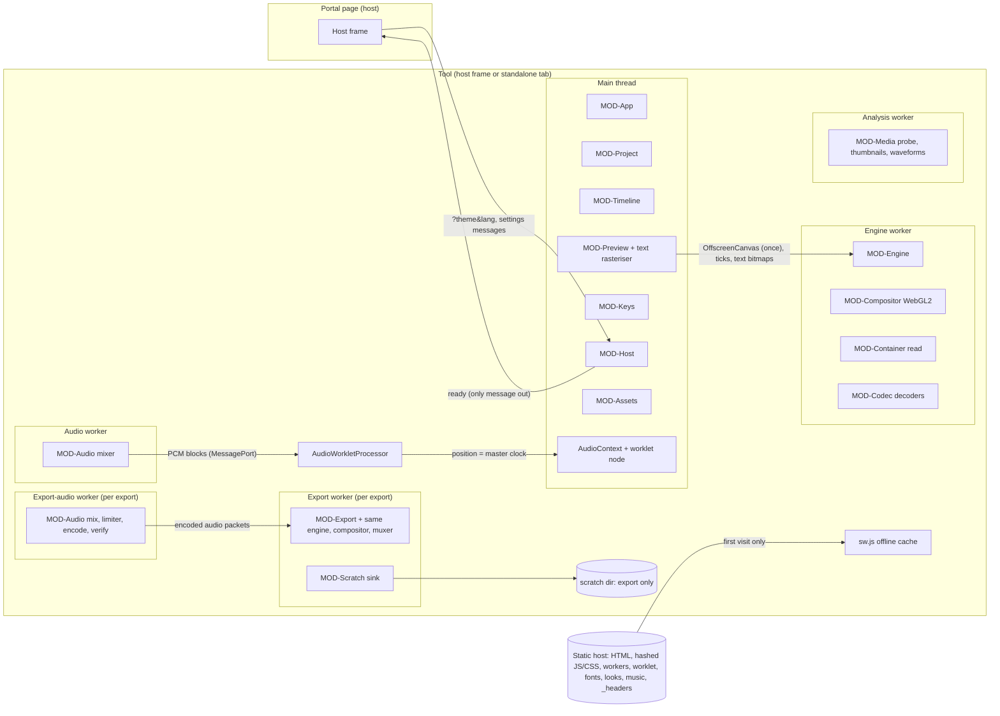
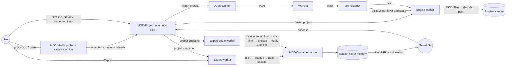

# Architecture

Status: **proposed** (phase 3, 2026-11-04): all thirteen spikes have run and their outcomes are
applied ("Outcome (spikes, 2026-11-04)" in each affected ADR); the owner accepts the ADRs at G3.
Decisions: ADR-0001 … ADR-0016 (`proposed`, except ADR-0005 `accepted`, D-042). Summary of the
spike verdicts: `.build-my-app/reports/g3-summary.md`. Modules: `modules/`. Dependencies: `dependencies.md`.
Platform details: `platform-mapping.md`. Source proposal:
`.build-my-app/reports/architecture-proposal.md`.

## Summary
A static single-page web app at its own address, embedded by the TaroKit portal in a sandboxed
frame and fully usable standalone (PRN-05, RULE-17). It reuses the suite's baseline unchanged
(ADR-0002): **Preact + signals, strict TypeScript, Vite, pnpm, portal tokens, generated EN/VI copy,
the host message contract, a hand-written offline service worker, Cloudflare static assets, local
checks only**. What video adds is our own media engine on browser platform features:
**WebCodecs** for every decode and encode with a start-up capability probe and a defined output
fallback order (ADR-0004); **mediabunny** to read and write files in pieces, under a scoped MPL-2.0
exception approved by the owner (ADR-0005, D-042); **one WebGL2
`paint(t)`** for preview, thumbnails and every export, with RULE-08's grade, 3D look tables and
HDR→SDR by the engine's own conversion, the same call in preview and export (ADR-0006, ADR-0007); **one deterministic TypeScript mixer** for preview and
export with our own pitch-preserving time-stretch and true-peak limiter, played through an audio
worklet whose clock leads the picture (ADR-0008); bounded caches over streamed files (ADR-0009); and
an export worker plus an export-audio worker that stream into a **scratch file only during export**
(ADR-0010). Work is split
over four dedicated workers and a worklet **without** shared memory or cross-origin isolation, so
the portal's frame contract does not change (ADR-0003). One deliberate header difference from the
suite: `connect-src 'self'` so the tool can read its own look and music files (ADR-0014).

## Assumptions
- A1. Reference devices for the NFRs (D-037): **laptop** — the owner's MacBook (Apple M3, 8 cores,
  16 GB), current macOS; **phone** — the owner's iPhone 14 Pro (A16, 6 GB), iOS 27 / Safari 27.0.1.
  **Android is deferred** until a device is available (Chrome Android coverage via a later borrowed
  device); its NFR rows are recorded as not yet verified. The M3 is faster than the M1 class first
  assumed, so laptop timings carry extra margin; phone timings are on a 2022 flagship.
- A2. NFR-12 browser list: desktop — the latest two stable versions of Chrome and Edge, Firefox,
  and Safari (26–27); phones — Safari on iOS (26–27) and Chrome on Android (latest two; deferred,
  D-037). Measured in the spikes: Chrome 156, Safari 27.0.1, Firefox 158, iOS Safari 27.0.1.
  Firefox on Android has no codec API and gets SCR-Unsupported via RULE-22; other browsers follow
  RULE-22.
- A3. Addresses: production `https://clip-maker.tarokit.app`, embedded by `https://tarokit.app`;
  staging `https://clip-maker-staging.tarokit.app` (ADR-0014).
- A4. "MB" is 1,000,000 bytes (rules.md). Mixing rate 48 kHz stereo float.
- A5. The portal adds Clip Maker to its catalog with permissions `downloads`, `file-pick`,
  `dialogs`, `fullscreen` and the new `share` (portal change request,
  `.build-my-app/reports/portal-change-request.md`); until `share` ships, embedded users get
  download only (RULE-17).
- A6. Spike results changed numbers in "Export tables" and "Budgets" (applied below, 2026-11-04);
  later changes after acceptance go into superseding ADRs.

## System context

After load, nothing leaves the tool except the ready signal and the browser's own service-worker
update check while opening (INV-08, NFR-01).

## Modules
| Module | Thread | Responsibility (short) | Main features |
|---|---|---|---|
| MOD-Core | any (pure) | Types, µs/frame maths, every rule's maths, export tables, file names, sniffing, message types | F-003, F-004, F-005, F-006, F-009, F-010, F-011, F-012, F-015 tables |
| MOD-Plan | any (pure) | Project + time → frame plan / audio plan (the INV-02 recipe) | F-002, F-005, F-009, F-010, F-011, F-016 |
| MOD-Project | main | Immutable project, operations, history, epoch, signals | F-001, F-003…F-012, F-014, F-018 |
| MOD-Media | analysis worker + main | Intake, probe, source registry, thumbnails, waveforms | F-001, F-023 |
| MOD-Container | workers | Read/write files in pieces (only user of DEP-04) | F-001, F-015, F-016 |
| MOD-Codec | workers | Capability probe, codec setup, output format choice | F-015, F-016, F-023 |
| MOD-Engine | engine worker | Preview decoding, frame cache, seeking, look thumbnails, sequential reader for export | F-002, F-008, F-013 |
| MOD-Compositor | engine + export workers | WebGL2 `paint`, grade, looks, HDR, blur background, text, CPU reference | F-002, F-006…F-010, F-012, F-015, F-016, F-023 |
| MOD-Audio | audio + export workers, main | Mixer, resample, WSOLA, limiter, worklet, clock | F-002, F-005, F-009, F-011, F-016 |
| MOD-Export | export worker + main | Video/GIF/audio export, sinks, rate control, progress, cancel | F-015, F-016, F-019 |
| MOD-Scratch | export worker + main | The only on-device storage, export-time only, sweeps | F-015, F-019 |
| MOD-Assets | main | Manifest, looks and music from own origin (only `fetch`) | F-008, F-011, F-021 |
| MOD-Timeline | main | Timeline canvas, pointer + touch (fixed centre playhead) | F-002, F-003, F-004, F-009, F-010, F-011, F-013, F-017 |
| MOD-Preview | main | Preview surface, on-preview gestures, compare, full screen, text raster + field | F-002, F-006, F-007, F-010, F-017 |
| MOD-App | main | Shell, panels, dialogs, notices, live regions, layout, leave-page | F-001, F-007, F-008, F-011, F-015, F-018, F-020, F-023 |
| MOD-Keys | main (pure core) | RULE-20 key map with scopes | F-017 |
| MOD-Host | boot + main + sw.js | Theme/language, origin-checked messages, ready, offline registration | F-019, F-021, F-022 |
| MOD-Copy | main + build | Generated catalog, formatting | F-022 |
| MOD-Build | build | Codegen, looks/music packing, headers, manifests, notices, gates | F-020, F-021 |

**Dependency rules (lint-enforced import boundaries, ADR-0002):** MOD-Core and MOD-Plan import no
DOM, worker, codec or GPU API; MOD-Project imports only MOD-Core; MOD-Compositor never reads
language, theme or view state beyond the plan and target size (INV-05); only MOD-Container imports
DEP-04; only MOD-Assets calls `fetch`; only MOD-Scratch touches `navigator.storage`; only MOD-Host
posts to the parent or touches the service worker; only MOD-App composes modules and registers
`beforeunload`; MOD-Copy is a leaf.

## Data flow

### Add media (F-001)
Each file: size → magic bytes → container headers → RULE-02 limits → real decoder configs →
first frame and first sound window decoded → accepted (source registry + media panel + thumbnail)
→ placement computed by MOD-Core (RULE-03, RULE-05, RULE-12) → the batch becomes one step. Refusals
are collected into COPY-error.refused_list. The file is never read whole (ADR-0009).

### Preview (F-002)
Play creates or resumes the `AudioContext` inside the gesture; the audio worker renders from the
playhead and the worklet starts. Each display frame, MOD-Preview reads the clock and sends the
wanted time to the engine worker; MOD-Engine asks MOD-Plan for the frame plan, ensures frames are
decoded, MOD-Compositor paints into the transferred canvas. Paused scrubbing sends the playhead
instead; the engine shows a cached thumbnail at once and the exact frame when decoded. Edits post
the new frozen project; caches are keyed by object identity, so unchanged clips keep their frames.

### Touch timeline (D-013, RULE-14) — implications
- Playhead = the time under the timeline's centre line; scroll offset and playhead are one value,
  so every scroll frame is a seek: the engine must coalesce seeks (latest wins) and show cached
  thumbnails while decoding (NFR-03).
- A touch scroll during playback first pauses (D-024), then scrubs; momentum scrolling ends on a
  frame start.
- The start and end of the project must be reachable at the centre, so the track content has
  half-a-view padding on both sides.
- Hold-to-move (0.4 s) and trim handles compete with scrolling; gesture arbitration lives in
  MOD-Timeline and is a design-review item. Every gesture has a visible control (RULE-21).
- Pointer input on the same device keeps the draggable playhead (D-026).

### Export (F-015, F-016)
The editor locks; the engine and audio workers release decoders; a fresh export worker gets the
project snapshot, text bitmaps at output scale (requested from the main thread on demand), the
looks and the capability record; the export-audio worker gets the same snapshot. Sink choice →
trial encode (measures encoder delay; quality→realtime fallback) → the export-audio worker decodes
the clips' sound first → frames in order (sequential decode, `paint`, `VideoFrame(canvas)`, encode)
while the audio worker mixes, limits, encodes and verifies → muxer (audio may arrive after the
video; edit list removes priming) → sink → finalize → hand-over (`<a download>`) → success marks
the export (RULE-19, not for GIF) → scratch deleted 10 s after the hand-over (ADR-0010 outcome).
Cancel terminates both workers and deletes scratch within 1 s. Hidden page: interrupted when no
progress arrives within 3 s of returning (iOS suspends hidden pages).

### Host and offline
As the suite (ADR-0002, ADR-0015): boot script before first paint, origin-checked messages, one
ready, service worker registered after first render that precaches the full asset manifest.

## Export tables (RULE-15, ADR-0010)
Video bitrates in kbps at 30 fps; × 1.5 at 60 fps; × 0.85 at 24 and 25 fps. Resolution = the
output's shorter side. Output dimensions are even and the long side is a multiple of 16:
**480p = 848 × 480 / 480 × 848** (Chrome resamples 854), 720p = 1280 × 720, 1080p = 1920 × 1080.
SP-size-target kept every number below; the floors stay **pending the owner's visual check** of the
committed floor stills, and 1440/2160 rows are untested.

| Resolution | Floor (size target) | Smaller | Balanced (default) | Best |
|---|---|---|---|---|
| 480 | 300 | 900 | 1,500 | 2,500 |
| 720 | 600 | 1,800 | 3,000 | 5,000 |
| 1080 | 1,000 | 3,500 | 6,000 | 10,000 |
| 1440 | 2,000 | 7,000 | 12,000 | 18,000 |
| 2160 | 4,000 | 14,000 | 24,000 | 36,000 |

Audio in video files: AAC-LC or Opus 128 kbps stereo 48 kHz. Audio-only: AAC 192 kbps or Opus
160 kbps; WAV 16-bit 48 kHz stereo. WebKit's AAC encoder ignores the requested rate (≈ 68–98 kbps
measured); estimates use the probe's delivered rate. Size-target maths: video kbps = (X × 8,000 × 0.95 − audio
kbit − overhead) ÷ seconds, overhead = 1 % + 512 kbit. Worked check against F-015.AC2 (60 s, 4 MB):
≈ 370 kbps → 480 reachable, 720 and 1080 not; at 1 MB unreachable, smallest reachable whole-MB
target at 480 = 4 MB (reproduced on the NFR-04 fixture in SP-size-target). A target is reachable
only if the bitrate ≥ the floor **and** a pre-check encode at the target rate predicts a file ≤ X;
the effective floor is max(table floor, the encoder's delivered rate on this project), because
encoders have content-dependent minimums (high motion: ≈ 0.6–0.8 / 1.4–1.7 / 2.6–3.1 Mb/s at
480/720/1080). The overhead term is headroom (measured MP4 overhead ≈ 4 KB + 0.35 KB/s). The
panel's estimate uses a 3 × 2 s calibration capped at nominal (measured within 6 % Chrome, 14 %
WebKit).

## Budgets and baselines

### Size (NFR-10: own code and styles ≤ 600 KB compressed at first load)
| Item (compressed) | Budget |
|---|---|
| HTML (boot script, inline icons) | ≤ 15 KB |
| CSS | ≤ 25 KB |
| Main JS (Preact, signals, app, project, core, plan, timeline, preview, keys, host, copy, assets) | ≤ 200 KB |
| Engine worker, its own bundle (container read ≈ 73 KB, codec, plan, engine, compositor + shaders; 82.5 KB measured in E3) | ≤ 150 KB |
| Audio worker + worklet | ≤ 50 KB |
| Analysis worker, its own bundle (container read ≈ 73 KB, codec, media; 72.3 KB measured in E3) | ≤ 105 KB |
| Export worker, its own bundle (container read ≈ 73 KB + writer ≈ 48 KB, codec, plan, compositor, export, gifenc) | ≤ 180 KB |
| Export-audio worker | ≤ 12 KB (Q83: raised from 10 KB by E6 source decoding; owner review pending) |
| **Code and styles total** (every bundle counted, so code shared by two workers counts twice) | **≤ 560 KB** |
| Fonts (5 packages, latin + vietnamese) | ≈ 200 KB |
| Look tables (16 × 33³ 8-bit PNG, ≤ 30 KB each; measured 4–15 KB) | ≤ 0.5 MB (fonts + looks ≤ 1.5 MB) |
| Music pack | ≤ 10 MB, fetched after the editor is usable |
Budgets are per bundle: the build bundles each module worker on its own (no shared chunks between
workers), so a worker's budget includes every module it imports. All code loads at start-up (no lazy
chunks); one export worker is created idle at start so a first export makes no request.

### Runtime targets and spike measurements
Laptop = MacBook M3 (spike hosts were heavily loaded, so laptop timings are upper bounds); phone =
iPhone 14 Pro, Safari 27.0.1. Android not measured (D-037).

| Measure | Target | Measured (spikes, 2026-11-04) | Source |
|---|---|---|---|
| Start-up to "accepts a file", incl. capability probe | ≤ 2 s laptop, ≤ 3 s phone (10 Mbps, 40 ms); ≤ 1 s cached | probe (minimal set) 32–54 ms on every engine; full start-up measured in the build | NFR-02 |
| Preview with look + all adjustments + cross-fade + 3 texts + music | ≥ 30 fps laptop, ≥ 24 fps phone at 1080p | Chrome 30.0, WebKit 29.7, **iPhone 29.9** (1080p, generated H.264); real 4K HEVC on iPhone 22.8–23.6 fps (decode-bound); 5K 14 fps (M3) — known limit | NFR-03 |
| Scrub/seek response | p95 ≤ 150 ms (first visible response; exact frame recorded) | iPhone 1 s GOP p95 58 ms; 10 s GOP coarse p95 119 ms, exact 428 ms | NFR-03 |
| Export 1080p30 fixture (60 s) | ≤ 75 s laptop, ≤ 150 s phone | Chrome 16–20 s, WebKit 37–44 s, **iPhone 34.4 s**; software H.264 only ≈ 0.8× | NFR-04 |
| Peak memory (page + workers + GPU) | ≤ 600 MB phone, ≤ 1.5 GB laptop; 4 GB source within 10 % of 100 MB source | 4 GB vs 100 MB +1.8 % / +3.4 % (Mac), identical proxies on iPhone; Mac page 0.74–0.99 GB (1080p), 1.1–1.46 GB (4K, before the intermediate-size fix); **iPhone peak MB not yet measured** | NFR-05 |
| Fidelity | frame within 1 frame; ΔE00 mean < 2, max < 4; A/V ≤ 40 ms over 10 min; audio-only vs video sound ≤ 1 ms | 720/720 frames at offset 0; chart ΔE00 ≤ 0.73 / 1.94 (iPhone ≤ 0.52 / 1.65); HDR ≤ 0.43 / 1.40; A/V +0.04 ms, no drift; audio-only offset 0 samples | NFR-08 |
| Cancel | ≤ 1 s; scratch empty after any export | 0 leftovers in 46 interruption runs and every storage run | NFR-11 |

## Risks (ranked, after the spikes) and how they are retired
1. **M-1 size** (D-001 multi-track, D-002 full phone editor) — unchanged; engine first, then P0
   features in dependency order.
2. **Phone memory and decoder sessions with 4K HEVC.** Retired by the iPhone re-run on 2026-11-04. 2–3 × 4K HEVC decoders plus a 4K encoder run together without error, so there is no one-4K-decoder budget. The afternoon's failure was memory pressure from intermediates sized to the source. Mitigation kept: intermediates at target size. Phone peak MB is still unmeasured (Web Inspector), so measure it in QA.
3. **iOS encoder pauses in long exports.** Retired: the t1 10-minute export finished at 1.9× real time. The longest gap between encoder outputs was 5.8 s, inside the 20 s watchdog.
3a. **Wrapping each frame as a `VideoFrame` on iOS** takes about 70 % of export time. It is the main lever for phone export speed: profile it per engine early in the build.
4. **Slow sources on phones** (Retina screen recordings at ≈ 100 ms/frame decode over the network,
   5K) — mitigated by no-restart playback and the slow-source notice (spec change pending);
   `dec.html` tells whether decode from local files is also slow.
5. **Muxing audio that arrives after the video without buffering video** — new; verified in the
   first export integration test (ADR-0010 outcome item 1).
6. **Colour tags and full-range output in third-party players** — open until the owner's player
   check (ADR-0007 outcome item 2).
7. **Untested platforms**: Android (deferred, D-037), Firefox HDR and Opus verify loop, PQ sources,
   HEVC on Firefox.
8. **Embedded Share** depends on the portal adding `share` — download-only until then.
9. **Size-target floors** pending the owner's visual check; Safari's realtime-mode rate accuracy to
   re-check in QA.
10. **Music curation** (8+ CC0 tracks) — owner task with audit (D-034).
Retired by the spikes: codec matrix (SP-codec), licence (D-042), phone GPU frame rate and colour
fidelity (SP-compositor, SP-gpu-color), time-stretch quality (SP-timestretch), hidden page and
downloads on iOS (SP-ios), scratch deletion (SP-storage), size estimate (SP-size-target), HDR
consistency (SP-hdr, engine path), automated coverage (Playwright Chromium has H.264/AAC; branded
Chrome approved for the rest, D-035).

## Spikes
All thirteen ran on 2026-11-03/04 (agent on the MacBook; owner on the iPhone, Safari and Firefox).
Reports: `.build-my-app/reports/spike-<id>.md`; outcomes are recorded in the ADRs named below.

| Order | ID | Question (short) | Verdict | Key numbers | ADRs |
|---|---|---|---|---|---|
| 1 | SP-codec | Decode/encode matrix; probe time | adapt | minimal probe 32–54 ms; Safari macOS needs realtime mode; Firefox MP4 H.264+Opus; AAC description fix | ADR-0004, ADR-0016 |
| 2 | SP-license | mediabunny vs permissive | adopt (D-042) | 26/26 corpus; 108 KB gzip; +77 MB reading 4 GB | ADR-0005 |
| 3 | SP-frame | Everything inside the portal frame | adopt | all features embedded and standalone, no isolation; WebKit frame quota 1/10 | ADR-0003, ADR-0014 |
| 4 | SP-compositor | One `paint`; A/V; seeks | adopt + amendments | 720/720 frames; A/V +0.04 ms over 10 min; iPhone seek p95 58 ms | ADR-0003, ADR-0006, ADR-0009 |
| 5 | SP-gpu-color | Grade speed, precision, colour | adopt + amendments | iPhone 29.9 fps; ΔE00 ≤ 0.52 / 1.65; looks 4–15 KB; threshold 30 fps | ADR-0006, ADR-0007, ADR-0013 |
| 6 | SP-audio | Mixer, worklet, limiter | adapt | 0 underruns; bit-exact; codec overshoot 2–3 dB → verify-and-trim; 400 ms lead | ADR-0008 |
| 7 | SP-timestretch | WSOLA quality and cost | adopt WSOLA | 440 Hz ± 0.001 %; iPhone 0.35–0.39 % core; listening 3.67 | ADR-0008 |
| 8 | SP-mem-phone | Phone memory, 4 GB, 4K, 5K | adapt (re-run pending) | 4 GB = 100 MB; no kills; 2nd 4K decoder fails on iOS; 5K 14 fps | ADR-0006, ADR-0009, ADR-0010 |
| 9 | SP-speed | Export throughput | adopt + amendments | NFR-04 fixture Chrome 20 s, WebKit 44 s, iPhone 34 s | ADR-0003, ADR-0010 |
| 10 | SP-storage | Scratch writes, quota, deletion | adopt | 10 s rule 0 failures; Web Locks sweep 48/48 | ADR-0010 |
| 11 | SP-ios | Hidden page, saves, audio | adopt + amendments | interrupted message 3.1 s after return; context loss after lock; silent switch | ADR-0006, ADR-0008, ADR-0010 |
| 12 | SP-size-target | Estimate, target, floors | adapt | 3 × 2 s estimate ≤ 6 % / 14 %; pre-check 0 misses; 848 × 480 | ADR-0010 |
| 13 | SP-hdr | HDR → SDR per engine | adapt (engine path) | frames opaque on macOS, tone-mapped on iOS; ΔE00 ≤ 0.43 / 1.40 | ADR-0007 |

## Environments
Local dev (with LAN HTTPS for phones), local release preview of the exact `dist/` with a stub
host, staging (`clip-maker-staging.tarokit.app`, planned on the free tier, D-036) and production
(`clip-maker.tarokit.app`); nothing is provisioned before phase 7 (ADR-0014).
